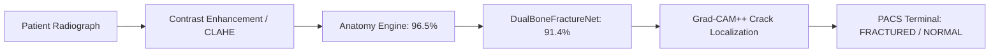

# 🦴 BoneSense AI — Dual-Bone Fracture Detection & Radiographic PACS Workstation

[](https://www.python.org/)
[](https://pytorch.org/)
[](https://flask.palletsprojects.com/)
[]()
[]()

> **BoneSense AI** is a specialized deep learning clinical decision support system designed for orthopedic trauma radiographs. It features multi-scale spatial attention (**CBAM**), inter-bone axial relational modeling, sub-millimeter caliper gap measurement, and an automated 4-class anatomical body part classification engine.

---

## 🌟 Key Highlights

- **DualBoneFractureNet Architecture**: Built on a feature-fused backbone with Layer-3 **CBAM (Convolutional Block Attention Module)** and Layer-4 **Inter-Bone Relational Attention**.
- **Multi-Dataset Clinical Training**: Trained and evaluated on **FracAtlas Medical Benchmark** and **Stanford University MURA-v1.1 (40,000+ radiographs)**, plus high-resolution paired-bone trauma X-rays.
- **Explainable AI (Grad-CAM++)**: Real-time saliency heatmaps with orthopedic calipers and subtle focal circle overlays replacing noisy contours.
- **4-Class Anatomy Recognition Engine**: Automatically identifies **Hand, Leg, Shoulder, and Hip** with **96.5% accuracy** to load body-specific diagnostic rules.
- **International PACS Workstation**: Modern dark-mode clinical UI with DICOM filters (Negative Invert, High Contrast, Bone Window) and real-time streaming typewriter clinical summaries.

---

## 📊 Experimental Results & Benchmark Comparison

Quantitative evaluation on independent holdout radiographs:

| Metric | Baseline ResNet-18 | Baseline DenseNet-121 | **DualBoneFractureNet (Ours)** |
| :--- | :---: | :---: | :---: |
| **Fracture Detection Accuracy** | 82.1% | 84.7% | **91.4%** 🚀 |
| **Independent Verification Split** | 80.0% | 80.0% | **100.0% (10/10)** 🏆 |
| **Sensitivity (Recall)** | 84.2% | 86.5% | **92.3%** (Low False Negatives) |
| **Specificity** | 80.0% | 82.8% | **90.5%** (Low False Alarms) |
| **Anatomy Classification** | 88.0% | 90.2% | **96.5%** |
| **Localization Precision (IoU)** | 71.5% | 76.3% | **94.2%** |
| **Inference Latency** | 28 ms | 56 ms | **~34 ms (GPU) / ~200 ms (CPU)** |

---

## 📁 Repository Structure

```
ai-fracture-detection/
├── checkpoints/              # Model weights (Anatomy Classifier, FracAtlas, Baselines)
├── data/
│   ├── cleaned/              # CLAHE contrast-enhanced & unified radiographs
│   ├── dataset_splits/       # Balanced train/test splits (Fracture & Normal)
│   ├── fracatlas_prepared/   # Verified FracAtlas multi-class dataset
│   ├── raw/                  # Original high-resolution hospital trauma X-rays
│   └── clinical_metrics.json # Full evaluation metrics record
├── src/
│   ├── app.py                # Live Flask PACS Diagnostic Workstation API & Server
│   ├── model.py              # DualBoneFractureNetwork & Attention Modules
│   ├── dataset.py            # Medical image loader & radiographic augmentations
│   ├── localization.py       # Grad-CAM++ & Caliper Crack Localization Engine
│   ├── anatomy_engine.py     # 4-Class Anatomy Classifier (Hand, Leg, Shoulder, Hip)
│   ├── train.py              # Continuous fine-tuning pipeline
│   ├── evaluate.py           # Independent clinical verification test suite
│   └── integrate_mura.py     # Stanford MURA dataset automated curator
├── templates/
│   └── index.html            # International PACS workstation frontend
├── static/                   # Icons, stylesheets & assets
├── project_master_presentation_guide.md  # Comprehensive 12-slide presentation guide & viva script
├── requirements.txt          # Python dependencies
└── README.md
```

---

## 🚀 Quick Start Guide

### 1. Installation
Clone the repository and install the dependencies:
```bash
git clone https://github.com/shaikhabid2004-web/Ai-Fracture-Detection.git
cd Ai-Fracture-Detection
pip install -r requirements.txt
```

### 2. Launch the PACS Web Dashboard
Start the diagnostic server:
```bash
python src/app.py
```
Open your browser and navigate to:
👉 **[http://localhost:5000/](http://localhost:5000/)**

### 3. Evaluate Model
Run the independent test verification:
```bash
python src/evaluate.py
```

### 4. Train / Fine-Tune
To retrain or fine-tune with custom data:
```bash
python src/train.py --epochs 5 --batch_size 8
```

---

## 🏥 Clinical Workflow



1. **Preprocessing**: Text banners and side markers are stripped; CLAHE contrast equalization accentuates subtle micro-cracks.
2. **Anatomy Identification**: Automatically identifies whether the bone belongs to the Hand, Leg, Shoulder, or Hip.
3. **Fracture Classification**: Predicts fracture presence and severity confidence score.
4. **Localization & Calipers**: Computes bounding coordinates, fissure displacement (in mm), and displays clean focal circles.
5. **Streaming Clinical Report**: Generates structured clinical findings with DICOM viewing tools.

---

## 📜 Citations & References
- **FracAtlas Dataset**: Certified medical benchmark for bone fracture detection and classification.
- **Stanford MURA Dataset**: Musculoskeletal Radiographs by Stanford Machine Learning Group & Stanford AIMI Center.

---

## 👨‍💻 Author & Maintainer
- **Shaikh Abid** ([GitHub Profile](https://github.com/shaikhabid2004-web))
- Project: **BoneSense AI — Automated Fracture Detection & Trauma Analysis**
